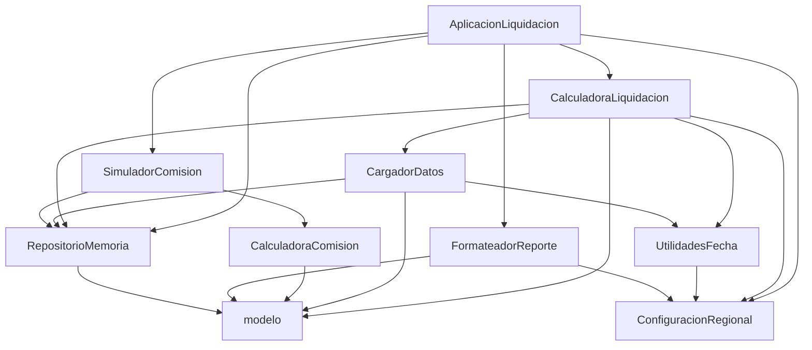

> Los tiempos de este respaldo son aproximados. Miden los comandos de cada paso, no la
> generación del texto.

> **Paso 1, usar la salida del final.** En la ejecución de verificación, la máquina no
> tenía el SDK de .NET 10 y la línea base salió en rojo. Esa salida no sirve como respaldo.
> La sección «Paso 1, ejecución real con .NET 10», al final, es la que se muestra en clase.

# Lab 5.1 salida grabada de respaldo

Nota sobre los segundos: son los medidos entre el inicio y el fin de los comandos de cada paso. No incluyen el tiempo de generación del texto. Sin llamadas MCP en este lab. Reinicio previo con `bash scripts/reiniciar-lab.sh lab-5-1 --si`: ya estaba en el punto de partida.

## Paso 1: `/lab-5-1-paso-1-levantar-y-verificar`

Segundos: 12 en total (mvn 3, build .NET 0,3, test .NET 1, comparador 2, más lecturas).

**El paso no resultó: la compilación .NET falla por el ambiente.** Según el skill, ante un fallo hay que detenerse, mostrar el error y no arreglarlo. Se ejecutaron los cuatro comandos seguidos en una sola llamada de terminal, así que los comandos 3 y 4 corrieron igualmente (no se corrigió nada ni se instaló nada). Los pasos 2 a 4 se ejecutaron después, solo con el escenario Java.

### Respuesta final del chat

Línea base: **no está en verde**. Hay un fallo de ambiente en .NET y debes avisar al relator antes de seguir.

| Comando | Resultado | Duración aproximada | Observación |
|---|---|---|---|
| `mvn -q clean package` (en `escenario/java/`) | Correcto, código 0; generó `target/liquidacion-comercios.jar` | 3 s | Sin errores ni advertencias visibles |
| `dotnet build LiquidacionComercios -c Release` (en `escenario/dotnet/`) | **Falla**: `error NETSDK1045: The current .NET SDK does not support targeting .NET 10.0` | menos de 1 s | El SDK instalado es 8.0.401 y el proyecto apunta a `net10.0`. No lo arreglé ni instalé nada |
| `dotnet test LiquidacionComercios.Pruebas` (en `escenario/dotnet/`) | **Falla** por el mismo error NETSDK1045 | 1 s | No corrió ninguna prueba .NET |
| `bash scripts/comparar-escenarios.sh` (raíz) | **Falla**, código 2: «El escenario .NET no compila»; el Java sí compiló | 2 s | No llegó a comparar salidas |

Pruebas que corrieron: 20 (Java: 6 de `ComercioTest`, 6 de `TransaccionTest` y 8 de `ValidadorFormatoTest`, todas correctas; leídas de `target/surefire-reports`). Pruebas .NET: 0.

Última línea del comparador: `Time Elapsed 00:00:00.26` (del log de compilación .NET que muestra, con `Build FAILED.` y `0 Warning(s)`, `1 Error(s)` justo antes). El comparador no imprimió el resumen de equivalencia.

Fuera del alcance, no tocado: ninguno adicional; el problema es la versión del SDK de .NET de esta máquina, no el código.

Salida esperada (tabla y cantidad de pruebas y última línea del comparador): entregada, pero la línea base NO quedó en verde, por lo que el objetivo del paso (todo en verde) no se cumplió en este ambiente.

## Paso 2: `/lab-5-1-paso-2-mapa-del-sistema java`

Segundos: 29. Archivos leídos: todos los de `escenario/java/src/main/java/...` relevantes. Verificación posterior: se comprobó con un script que las rutas citadas existen.

### Respuesta final del chat

He creado `labs/cap5/lab-5-1-preparacion/entregables/mapa-del-sistema.md` con la tabla de componentes (rutas reales), el diagrama Mermaid de dependencias y el recorrido de los datos desde `escenario/datos/*.txt` hasta la salida impresa. Comprobé que todas las rutas del documento existen en el repositorio.

Observaciones fuera del alcance, sin tocar: `CalculadoraLiquidacion` no usa `CalculadoraComision` y repite el cálculo en línea; `ValidadorFormato` solo lo usan las pruebas.

Salida esperada (documento creado): cumplida.

### Archivo creado: `mapa-del-sistema.md`

# Mapa del sistema (escenario Java)

Rutas relativas a la raíz del repositorio. Código en
`escenario/java/src/main/java/pe/pasarelaandina/` (en la tabla se abrevia `P/`). Datos en
`escenario/datos/`.

## 1. Componentes

| Clase | Ruta real | Responsabilidad |
|---|---|---|
| AplicacionLiquidacion | `escenario/java/src/main/java/pe/pasarelaandina/AplicacionLiquidacion.java` | Punto de entrada: fija UTF-8, lee periodo y ruta de datos, orquesta la carga, la liquidación, el reporte y la simulación |
| CalculadoraLiquidacion | `P/calculo/CalculadoraLiquidacion.java` | Cierre mensual: filtra transacciones, calcula comisiones, tope, contracargos, retención e imprime por consola |
| CalculadoraComision | `P/calculo/CalculadoraComision.java` | Comisión de una transacción (tramo, monto fijo, recargo); solo la usa el simulador |
| SimuladorComision | `P/calculo/SimuladorComision.java` | Estima la comisión de una venta hipotética para un comercio |
| UtilidadesFecha | `P/calculo/UtilidadesFecha.java` | Parseo y formato de fechas, inicio y fin de periodo, meses entre fechas |
| CargadorDatos | `P/repositorio/CargadorDatos.java` | Lee los cuatro archivos de texto y llena el repositorio |
| RepositorioMemoria | `P/repositorio/RepositorioMemoria.java` | Almacén en memoria de comercios, planes, transacciones y contracargos, con búsquedas |
| FormateadorReporte | `P/reporte/FormateadorReporte.java` | Arma el resumen general y el detalle de una liquidación |
| ConfiguracionRegional | `P/util/ConfiguracionRegional.java` | Constante `Locale.ROOT` para todo formateo de salida |
| ValidadorFormato | `P/util/ValidadorFormato.java` | Validaciones de formato (registro tributario, código de autorización, id, periodo) |
| Comercio, Transaccion, Contracargo, PlanComisiones, TramoComision | `P/modelo/` | Entidades de entrada |
| Liquidacion, DetalleLiquidacion | `P/modelo/Liquidacion.java`, `P/modelo/DetalleLiquidacion.java` | Resultado del cierre y sus líneas |
| CategoriaNegocio, EstadoComercio, EstadoContracargo, EstadoTransaccion, MedioPago, MotivoContracargo | `P/modelo/` | Enumeraciones |
| Pruebas | `escenario/java/src/test/java/pe/pasarelaandina/modelo/ComercioTest.java`, `escenario/java/src/test/java/pe/pasarelaandina/modelo/TransaccionTest.java`, `escenario/java/src/test/java/pe/pasarelaandina/util/ValidadorFormatoTest.java` | Pruebas JUnit |

## 2. Dependencias



`ValidadorFormato` no tiene dependientes en el código principal; solo lo usan las pruebas.
`CalculadoraLiquidacion` no usa `CalculadoraComision`: repite el cálculo en línea.

## 3. Recorrido de los datos

1. `AplicacionLiquidacion.main` toma el periodo (por omisión `2026-06`) y la ruta de datos
   (por omisión `../datos`, es decir `escenario/datos/` al ejecutar desde `escenario/java/`).
2. `CalculadoraLiquidacion.prepararDatos` crea un `RepositorioMemoria` y llama a
   `CargadorDatos.cargarTodo`.
3. `CargadorDatos` lee, en este orden, `escenario/datos/planes.txt`, `escenario/datos/comercios.txt`,
   `escenario/datos/transacciones.txt` y `escenario/datos/contracargos.txt`, separados por punto y
   coma, y deja objetos del paquete `modelo` en el repositorio.
4. `CalculadoraLiquidacion.procesarLiquidacionCompleta` recorre los comercios; por cada uno busca el
   plan, sus transacciones y sus contracargos en el repositorio, calcula y arma un objeto `Liquidacion`
   con sus `DetalleLiquidacion`.
5. Por cada comercio con transacciones liquidadas se imprime un bloque por consola.
6. `FormateadorReporte` imprime el resumen general y el detalle de la primera liquidación.
7. `SimuladorComision` imprime la simulación de una venta de 1500.00 en 3 cuotas para los tres primeros
   comercios liquidados.

## Paso 3: `/lab-5-1-paso-3-inventario-de-riesgos java`

Segundos: 65. Se ejecutó `java -jar target/liquidacion-comercios.jar 2026-06` desde `escenario/java/` y un cálculo en Python con `Decimal` (script temporal fuera del repositorio) para la regla 9.

### Respuesta final del chat

He creado `labs/cap5/lab-5-1-preparacion/entregables/inventario-de-riesgos.md` con la tabla de las nueve reglas y el inventario priorizado, y no corregí nada.

Demostración de la regla 9: recalculé con aritmética decimal exacta las comisiones de 2026-06 de los 39 comercios liquidados y las comparé con la salida del programa. Coinciden 36. Difieren tres, en un centavo, y los tres exactos caen en un punto medio: CM0011 (137.825 exacto, el programa imprime 137.82), CM0016 (493.995, imprime 493.99) y CM0025 (957.185, imprime 957.18). Es consecuencia de usar `double` y `Math.round(x * 100.0) / 100.0`.

Hallazgos principales: montos en `double` (3 comercios con 0.01 de diferencia); dos copias del cálculo con tope de recargo 3.0 frente a 3.5 y límite de tramo `<` frente a `<=` (`CalculadoraLiquidacion.java:149,173-175` y `CalculadoraComision.java:23,53-55`); el comentario de `PlanComisiones.java:9-10` que contradice la regla 2; excepciones tragadas en `CargadorDatos.java` y `CalculadoraLiquidacion.java:281-282`; método de unas 280 líneas; ausencia de pruebas de lógica de negocio. Todos quedaron registrados sin corregir.

Nota de entorno: la línea base de .NET no pudo verificarse (paso 1), por lo que el inventario analiza solo Java.

Salida esperada (tabla de nueve reglas y tabla de inventario): cumplida.

### Archivo creado: `inventario-de-riesgos.md`

# Inventario de riesgos (escenario Java, periodo 2026-06)

Contraste de las nueve reglas de `escenario/README.md` con el código. Nada se corrigió.
Abreviaturas de ruta, dentro de `escenario/java/src/main/java/pe/pasarelaandina/`:
`Liq` = `calculo/CalculadoraLiquidacion.java`, `Com` = `calculo/CalculadoraComision.java`,
`Plan` = `modelo/PlanComisiones.java`, `Fecha` = `calculo/UtilidadesFecha.java`,
`Carg` = `repositorio/CargadorDatos.java`.

## 1. Las nueve reglas

| # | Regla | Dónde se implementa | ¿Se cumple? | Cuándo podría dejar de cumplirse |
|---|---|---|---|---|
| 1 | Porcentaje del tramo más monto fijo | `Liq:144-165`; también `Com:33-42` | Sí | Si un monto cae exactamente en un límite de tramo: `Liq:149` usa `<` y `Com:23` usa `<=`, y los dos cálculos darían porcentajes distintos |
| 2 | Tramos no acumulativos | `Liq:164`, `Com:39` | Sí | Quien tome como especificación el comentario de `Plan:9-10` (dice «acumulativos») reescribiría el cálculo al revés |
| 3 | Recargo 0,5 % por cuota sobre la primera, máximo 3 % | `Liq:169-178` (tope 3.0); `Com:48-57` (tope 3.5) | Sí en la liquidación; no en `CalculadoraComision` | `SimuladorComision` usa `Com`: con 8 o más cuotas estima un recargo mayor al de la liquidación real |
| 4 | Anuladas no generan comisión | `Liq:138` (solo `APROBADA`) | Sí | Si se agrega un estado nuevo que deba comisionar, queda excluido sin aviso |
| 5 | Contracargos aprobados, en el periodo en que se aprueban | `Liq:211-226`; el contracargo se asocia al comercio por su transacción (`repositorio/RepositorioMemoria.java:101-109`) | Sí | Si el contracargo apunta a una transacción que no se cargó, se pierde sin aviso (catch vacío en `Carg:156-157`) |
| 6 | Si el total supera el tope, se cobra el tope | `Liq:202-205` | Sí (CM0004 queda en 5000.00 con tope aplicado) | El acumulado general de comisiones se suma antes del tope (`Liq:196`), por lo que no coincide con lo cobrado |
| 7 | Retención del 5 % con menos de seis meses | `Liq:230-244`, `Fecha:125-143` | Sí, con la interpretación de «monto neto» como transado menos comisiones menos contracargos | Los literales `6` y `0.05` (`Liq:236`, `Liq:241`) están repetidos en código; cualquier cambio de regla exige buscarlos |
| 8 | Periodo del primer día 00:00:00 al último 23:59:59, hora de Lima | `Fecha:77-108` | Sí en la práctica, sin garantía | Las fechas se interpretan con la zona horaria del sistema (`Fecha:34-36`, `util/ConfiguracionRegional.java:34-35`). Mientras los datos y los límites se interpreten con la misma zona el resultado es estable, pero la regla pide Lima y el código no la fija |
| 9 | Dos decimales, medio hacia arriba | `Liq:246-249`, `Liq:257-259`, `Com:71-73` | **No del todo** | Los montos son `double`. Ver el cálculo exacto más abajo |

## 2. Verificación de la regla 9 con aritmética decimal exacta

Se recalculó el total de comisiones del periodo 2026-06 con decimales exactos, aplicando la misma lógica
del código (tramo con `<`, monto fijo, recargo con tope 3.0, filtros de periodo, moneda y estado) y se
comparó con lo que imprime `java -jar target/liquidacion-comercios.jar 2026-06`. Coinciden 36 de los 39
comercios liquidados. Difieren tres, en un centavo:

| Comercio | Total exacto | Imprime el programa | Diferencia |
|---|---|---|---|
| CM0011 | 137.825 → 137.83 | 137.82 | 0.01 |
| CM0016 | 493.995 → 494.00 | 493.99 | 0.01 |
| CM0025 | 957.185 → 957.19 | 957.18 | 0.01 |

Los tres exactos caen en un punto medio y el `double` acumulado queda apenas por debajo, de modo que
`Math.round(x * 100.0) / 100.0` (`Liq:247`) redondea hacia abajo. Ejemplo completo: CM0001 da
727.34022175 exacto y 727.34 impreso, sin diferencia.

## 3. Inventario priorizado

| Problema | Ubicación | Regla afectada | Impacto | Esfuerzo | Prioridad |
|---|---|---|---|---|---|
| Montos en `double`: errores de redondeo en los puntos medios (3 de 39 comercios con 0.01 de diferencia en 2026-06) | `Liq:124-125`, `Liq:164-165`, `Liq:192-193`, `Liq:246-249`; `Com:33-42`; `modelo/Transaccion.java:12` | 9 (y 1, 3, 6, 7) | Alto: afecta dinero pagado y cualquier cambio de datos puede ampliarlo | Alto: transversal y debe mantener la equivalencia con .NET | 1 |
| Dos copias del cálculo de comisión con diferencias: tope 3.0 frente a 3.5 y límite `<` frente a `<=` | `Liq:149`, `Liq:173-175`; `Com:23`, `Com:53-55` | 1 y 3 | Medio: la simulación comercial promete comisiones que la liquidación no cobra | Medio | 2 |
| Comentario que afirma tramos acumulativos, contrario al código y a la regla 2 | `Plan:9-10` | 2 | Alto si alguien lo toma como especificación, nulo hoy | Bajo | 3 |
| Excepciones tragadas: líneas inválidas de los archivos de datos se descartan sin aviso | `Carg:65-66`, `Carg:95-96`, `Carg:127-128`, `Carg:156-157`, `Carg:170-171`; `Liq:281-282` | 1 a 7 (cualquier dato perdido) | Alto: comercios, transacciones o contracargos faltantes no dejan rastro | Bajo | 4 |
| Método de cálculo de unas 280 líneas con anidamiento profundo | `Liq:82-364` | 1 a 7 | Medio: bloquea la prueba aislada y la refactorización | Alto | 5 |
| Sin pruebas de la lógica de negocio: las pruebas existentes cubren modelos y validación de formato | `escenario/java/src/test/java/pe/pasarelaandina/modelo/ComercioTest.java`, `.../modelo/TransaccionTest.java`, `.../util/ValidadorFormatoTest.java` | 1 a 9 | Alto: no hay red de seguridad para cambiar nada | Medio | 6 |
| Zona horaria del sistema en lugar de Lima | `Fecha:34-36`; `util/ConfiguracionRegional.java:34-35`; `Liq:122` | 8 | Medio: depende de la máquina si cambia el origen de las fechas | Bajo | 7 |
| Números mágicos repetidos (`0.05`, `6`, `0.5`, `3.0`, `"PEN"`) | `Liq:66`, `Liq:171-174`, `Liq:236`, `Liq:241`; `Com:52-54` | 3, 7 | Medio: un cambio de regla se aplica en un lugar y no en el otro | Bajo | 8 |
| Estado mutable y efectos al validar: `validarTransaccion` valida y además suma acumulados y descartadas; `acumuladoGeneralComisiones` suma antes del tope | `Liq:34-36`, `Liq:57-76`, `Liq:196` | 6 | Bajo: son datos de control, no el monto liquidado | Medio | 9 |
| Nombres que no describen: `buscarComerciosActivos` devuelve todos los comercios y el filtro de baja ocurre en el cálculo | `repositorio/RepositorioMemoria.java:56-62`, `Liq:110-112` | ninguna | Bajo: confunde al leer; los suspendidos sí se liquidan | Bajo | 10 |
| Fechas con `Date` y `Calendar` | `Fecha:1-155`, `Liq:92-93`, `Liq:134-136` | 8 | Bajo | Medio | 11 |

## 4. Observaciones del entorno de esta ejecución

- El comparador `bash scripts/comparar-escenarios.sh` y la compilación .NET no pudieron ejecutarse: la
  máquina tiene el SDK de .NET 8.0.401 y el proyecto apunta a .NET 10.0 (error NETSDK1045). No es un
  problema del código del escenario; se informó al relator.

## Paso 4: `/lab-5-1-paso-4-criterios-de-evaluacion`

Segundos: menos de 1 de comandos; generación no medida.

### Respuesta final del chat

He creado `labs/cap5/lab-5-1-preparacion/entregables/criterios-de-evaluacion.md` a partir del inventario de riesgos, con 10 criterios. Cada uno dice cómo se comprueba y qué resultado lo da por cumplido. Incluye equivalencia entre escenarios (criterios 3 y 4), alcance del cambio (criterio 5), y criterios de reglas 2, 3, 9 y límites de tramo respaldados en los hallazgos. Los criterios 1 a 3 dependen de que el SDK de .NET del ambiente permita compilar (hoy falla, ver paso 1). Recuerda acordar estos criterios en sala antes de pasar al 5.2.

Tabla de salida:

| N.º | Criterio | Cómo se comprueba | Se cumple si |
|---|---|---|---|
| 1 | Los dos escenarios compilan | Java: `cd escenario/java && mvn -q clean package`. .NET: `cd escenario/dotnet && dotnet build LiquidacionComercios -c Release` | Ambos comandos terminan con código 0 y sin errores |
| 2 | Las pruebas existentes siguen pasando | Java: `cd escenario/java && mvn test`. .NET: `cd escenario/dotnet && dotnet test LiquidacionComercios.Pruebas` | Ambos terminan con código 0 y 0 pruebas fallidas; Java ejecuta al menos las 20 pruebas de la línea base |
| 3 | Equivalencia entre escenarios | `bash scripts/comparar-escenarios.sh` | Termina con código 0 y dice «Las salidas son identicas» |
| 4 | La salida del periodo 2026-06 no cambia en un refactor sin cambio de comportamiento | Guardar `java -jar target/liquidacion-comercios.jar 2026-06` desde `escenario/java/` antes y después, y comparar con `diff` | `diff` no muestra diferencias, línea por línea, en las 554 líneas de la línea base |
| 5 | Alcance del cambio | `git diff --name-only` y `git status --short` | Solo aparecen los archivos que el laboratorio nombra y cada línea modificada de `git diff -U0 -- escenario` pertenece a la parte que el laboratorio pidió tocar; ningún archivo de `escenario/datos/` ni de `escenario/java/src/test/` ni de `escenario/dotnet/LiquidacionComercios.Pruebas/` cambia salvo que el laboratorio lo pida |
| 6 | Regla 3: el recargo por cuotas tiene el mismo tope en la liquidación y en la simulación | Prueba que compare `CalculadoraComision.calcularRecargoCuotas` y el recargo de la liquidación con 8 y 10 cuotas sobre un mismo plan | Ambas dan el mismo valor para 8 y 10 cuotas; hoy difieren (3.5 y 3.0) |
| 7 | Regla 2: los tramos siguen sin ser acumulativos | Prueba con un plan de tramos y un monto de 1500.00 en el plan PL01 (tramo 500 a 2000, 2.9 %) | La comisión base es `1500.00 * 2.9 / 100 + 0.30 = 43.80`, no una suma repartida entre tramos |
| 8 | Regla 9: totales con redondeo medio hacia arriba sobre decimales exactos, si el laboratorio toca la aritmética | Prueba o salida de 2026-06 para CM0011, CM0016 y CM0025 | Imprimen 137.83, 494.00 y 957.19 respectivamente; hoy imprimen 137.82, 493.99 y 957.18 |
| 9 | Un cambio de estructura no altera los límites de tramo | Prueba con montos exactamente iguales a un límite de tramo (por ejemplo 500.00 en PL01) | El porcentaje aplicado es el del tramo siguiente, como hoy en la liquidación (`monto < hasta`) |
| 10 | Las pruebas nuevas prueban lógica de negocio y no solo formato | Revisión: cada prueba nueva llama a `CalculadoraComision` o `CalculadoraLiquidacion` y verifica un monto | Existe al menos una prueba por regla tocada y ninguna verifica solo getters |

Salida esperada (tabla Criterio, Cómo se comprueba, Se cumple si): cumplida (la columna lleva además un número).

### Archivo creado: `criterios-de-evaluacion.md`

# Criterios de evaluación para los laboratorios 5.2 y 5.3

Parten de `labs/cap5/lab-5-1-preparacion/entregables/inventario-de-riesgos.md`. Todos se
comprueban con un comando, una prueba o una revisión concreta. Los comandos se ejecutan desde la
raíz del repositorio, salvo que se indique otro directorio.

| N.º | Criterio | Cómo se comprueba | Se cumple si |
|---|---|---|---|
| 1 | Los dos escenarios compilan | Java: `cd escenario/java && mvn -q clean package`. .NET: `cd escenario/dotnet && dotnet build LiquidacionComercios -c Release` | Ambos comandos terminan con código 0 y sin errores |
| 2 | Las pruebas existentes siguen pasando | Java: `cd escenario/java && mvn test`. .NET: `cd escenario/dotnet && dotnet test LiquidacionComercios.Pruebas` | Ambos terminan con código 0 y 0 pruebas fallidas; Java ejecuta al menos las 20 pruebas de la línea base |
| 3 | Equivalencia entre escenarios | `bash scripts/comparar-escenarios.sh` | Termina con código 0 y dice «Las salidas son identicas» |
| 4 | La salida del periodo 2026-06 no cambia en un refactor sin cambio de comportamiento | Guardar `java -jar target/liquidacion-comercios.jar 2026-06` desde `escenario/java/` antes y después, y comparar con `diff` | `diff` no muestra diferencias, línea por línea, en las 554 líneas de la línea base |
| 5 | Alcance del cambio | `git diff --name-only` y `git status --short` | Solo aparecen los archivos que el laboratorio nombra y cada línea modificada de `git diff -U0 -- escenario` pertenece a la parte que el laboratorio pidió tocar; ningún archivo de `escenario/datos/` ni de `escenario/java/src/test/` ni de `escenario/dotnet/LiquidacionComercios.Pruebas/` cambia salvo que el laboratorio lo pida |
| 6 | Regla 3: el recargo por cuotas tiene el mismo tope en la liquidación y en la simulación | Prueba que compare `CalculadoraComision.calcularRecargoCuotas` y el recargo de la liquidación con 8 y 10 cuotas sobre un mismo plan | Ambas dan el mismo valor para 8 y 10 cuotas; hoy difieren (3.5 y 3.0) |
| 7 | Regla 2: los tramos siguen sin ser acumulativos | Prueba con un plan de tramos y un monto de 1500.00 en el plan PL01 (tramo 500 a 2000, 2.9 %) | La comisión base es `1500.00 * 2.9 / 100 + 0.30 = 43.80`, no una suma repartida entre tramos |
| 8 | Regla 9: totales con redondeo medio hacia arriba sobre decimales exactos, si el laboratorio toca la aritmética | Prueba o salida de 2026-06 para CM0011, CM0016 y CM0025 | Imprimen 137.83, 494.00 y 957.19 respectivamente; hoy imprimen 137.82, 493.99 y 957.18 |
| 9 | Un cambio de estructura no altera los límites de tramo | Prueba con montos exactamente iguales a un límite de tramo (por ejemplo 500.00 en PL01) | El porcentaje aplicado es el del tramo siguiente, como hoy en la liquidación (`monto < hasta`) |
| 10 | Las pruebas nuevas prueban lógica de negocio y no solo formato | Revisión: cada prueba nueva llama a `CalculadoraComision` o `CalculadoraLiquidacion` y verifica un monto | Existe al menos una prueba por regla tocada y ninguna verifica solo getters |


## Paso 1, ejecución real con .NET 10

Salida de los cuatro comandos del paso 1 sobre una copia limpia del repositorio de
participantes, con JDK 21 y SDK de .NET 10.0.401.

```
$ cd escenario/java && mvn -q clean package
rc=0

$ cd escenario/dotnet && dotnet build LiquidacionComercios -c Release
    0 Errores

Tiempo transcurrido 00:00:00.95

$ cd escenario/dotnet && dotnet test LiquidacionComercios.Pruebas
Correctas! - Con error:     0, Superado:    20, Omitido:     0, Total:    20, Duración: 20 ms - LiquidacionComercios.Pruebas.dll (net10.0)

$ bash scripts/comparar-escenarios.sh
== Comparacion ==
  [ OK ] Las salidas son identicas
       554 lineas, 20457 bytes

== Resumen ==
  Escenarios equivalentes. Java y .NET producen la misma salida para 2026-06.
```
